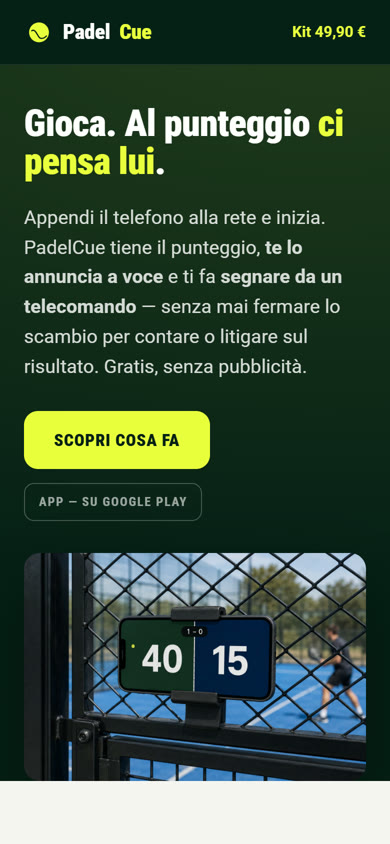

# PadelCue · sito

Landing page e privacy policy dell'app **PadelCue** (segnapunti per il padel con voce, telecomandi Bluetooth e Wear OS), pubblicate con GitHub Pages.

**Sito:** https://filippobonanno.github.io/segnapadel-site/
**Progetto:** [padelcue](https://github.com/FilippoBonanno/padelcue)

HTML e CSS scritti a mano, senza framework: guida passo passo, modalità voce completa / solo punteggio, FAQ sui telefoni supportati, storico partite e screenshot dell'app.

  
  

